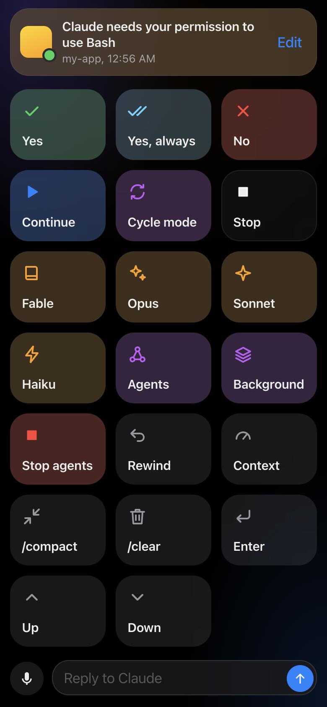
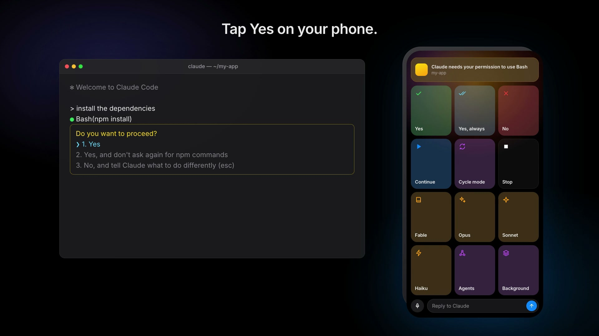

# Deckpad

**Turn a spare Android phone into a button pad for Claude Code.**
Plug it into your Mac and tap *Yes*, *No*, *Switch to Opus*, *Rewind* or *Background*,
or dictate a reply, without touching the keyboard. The phone lights up and buzzes
when Claude needs your permission.

<p align="center"></p>

- **Free.** No API key, no credits. Deckpad presses keys on your Mac; Claude Code does the rest.
- **Private.** Everything runs on your own Mac. Nothing is sent to any server, including ours (we don't have one).
- **Wired.** Plug in the phone and the pad opens on it automatically. Wi-Fi works too.
- **Yours.** Add, recolor, re-icon and reorder keys from the phone.
- **Tiny.** One Python file, standard library only.

**Watch the 23-second demo:** [deckpad-demo.mp4](site/deckpad-demo.mp4)

[](site/deckpad-demo.mp4)

> Unofficial. Deckpad is a community project and is not affiliated with or endorsed by Anthropic.

## Requirements

- macOS with Python 3.9+ (`python3 --version`)
- [Claude Code](https://code.claude.com) running in Terminal, iTerm or similar
- An Android phone and a USB cable
- `adb`: `brew install --cask android-platform-tools`

## Install

```bash
git clone https://github.com/thebharathkumar/Deckpad.git
cd Deckpad
python3 server.py --setup   # lets Claude Code tell the phone when it needs you
python3 server.py
```

### Set up the phone (one time)

1. **Settings → About phone →** tap **Build number** 7 times to unlock Developer options.
2. **Settings → Developer options →** turn on **USB debugging** and **Stay awake**.
3. Plug the phone into the Mac and tap **Allow** on *Allow USB debugging?*
   (tick *Always allow from this computer*).

The pad opens on the phone. From now on it opens whenever you plug in.
In Chrome's menu, choose **Add to Home screen** for a full-screen app.

### Allow keystrokes on the Mac (one time)

The first key you press makes macOS ask whether your terminal may control the computer.
Allow it in **System Settings → Privacy & Security → Accessibility**.

## Using it

| Key | Does |
|---|---|
| Yes / Yes, always / No | answers Claude's permission prompt |
| Continue · Cycle mode · Stop | `continue`, Shift+Tab, Ctrl+C |
| Fable · Opus · Sonnet · Haiku | `/model …` |
| Agents · Background · Stop agents | `/tasks`, Ctrl+B, Ctrl+X Ctrl+K |
| Rewind · Context | Esc Esc, `/context` |
| /compact · /clear · Enter · Up · Down | what they say |

**Reply box:** type, or tap the mic and talk, then send. The text is typed into Claude and submitted.

**Edit keys:** tap **Edit**, then tap any key to change its label, what it types, color or symbol.
What it types is plain text plus keys in braces:

```
/model opus{enter}      types a command and presses Return
{shift+tab}             presses a combo
{esc}{wait}{esc}        presses Esc, pauses, presses Esc
```

Keys: `{enter} {esc} {tab} {space} {backspace} {up} {down} {left} {right} {wait}`
with `shift+ ctrl+ cmd+ alt+` combos, such as `{ctrl+c}`.

**Send keys to app** (in Edit): leave blank to type into the window in front, or name an app
(`Terminal`, `iTerm`) so Deckpad switches to it first.

## Options

```bash
python3 server.py --link        # show the pairing links again
DECK_USB_ONLY=1 python3 server.py   # USB only: nothing reachable over Wi-Fi
DECK_DRY_RUN=1 python3 server.py    # print keystrokes instead of sending them
DECK_PORT=9000 python3 server.py    # use another port
./autostart.sh on               # start at login (USB only); `on wifi` to allow Wi-Fi
./autostart.sh off              # stop starting at login
python3 server.py --uninstall   # remove the Claude Code hooks
```

### Wi-Fi instead of a cable

Start `server.py` and open the `http://192.168.x.x:8765/pair?t=…` link it prints on your phone,
on the same network. The link is the password: anyone with it can press your keys, so keep it private.
Delete `.deck_token` and restart to revoke it.

## Security

Deckpad presses keys on your computer, so it is built to be locked down:

- A random 192-bit pairing token, stored on the phone as an HttpOnly, SameSite=Strict cookie.
- Over USB the server can be bound to localhost only (`DECK_USB_ONLY=1`, the autostart default).
- On Wi-Fi only private-network and Tailscale addresses are accepted, and 8 wrong tokens lock an address out for 10 minutes.
- Other websites can't press your keys: every action needs a custom header that browsers won't send cross-site.
- The phone can only run your saved keys or type text. There is no endpoint that runs shell commands, and text goes to AppleScript as data, never as code.
- Only your own Mac can post Claude's status updates.

Plain Wi-Fi traffic is not encrypted. Use the cable, or [Tailscale](https://tailscale.com) (`tailscale serve 8765`), on networks you don't trust.

## How it works

```
Claude Code ──hook──▶ server.py ──status──▶ phone (shows it, vibrates)
phone ──tap──▶ server.py ──AppleScript keystrokes──▶ Terminal running Claude Code
          (USB via `adb reverse`, or Wi-Fi)
```

## License

MIT
